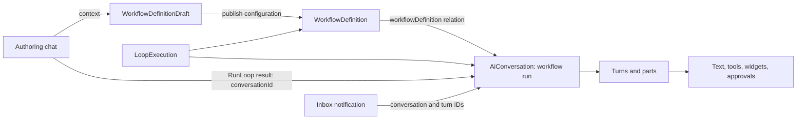

# Linear chat and automations

Inspected 2026-10-13 against the October 12 client family. **A native Loop run is an
AiConversation linked to a WorkflowDefinition. A chat that configures a Loop is a
different conversation, carrying a definition/draft reference in context.**
The same renderer displays run transcripts, ordinary chats, and entity results.

This is a behavior/integration map, not a shipped UI or pixel specification.
EXTRACTED means inspected client behavior; VERIFIED means a narrow live observation
in the [probe ledger](../reference/chat-automations-probes-2026-10-13.md).
DESIGN labels our proposal. UNVERIFIED remains a concrete gap.
[A1] and other citations resolve to the [source index](../reference/chat-automations-sources-2026-10-13.md),
which pins hashes and UTF-8 byte offsets. No vendor implementation is included.

## 1. Evidence reconciliation

Read the [Agent live capture](../reference/live-agent-protocol-2026-10-12.md) and
[MCP live capture](../reference/live-mcp-system-2026-10-12.md).
The requested live-linear-agent-api-2026-10-12.md is absent at base ab66d17;
live-agent-protocol-2026-10-12.md is its available counterpart.
Also inspected the integration map on in-linear-chat-protocol at 24e088e
([PR 376](https://github.com/I-am-drunk/linear-loops-decompile/pull/376)).
That map mostly pins September artifacts; this map pins October artifacts.

The earlier map's session-cookie and send/poll unknowns have subsequent live
observations. Ordinary chat sending remains distinct from native Loop execution.
The previous zero-balance chat/MCP examples are account observations, not universal
pricing or trial-independent entitlement. No published native Loop was run here.

## 2. Entities and identities

EXTRACTED [A1, A2, A5], except specific live checks below.

| Model | Role and links |
|---|---|
| WorkflowDefinition | Published configuration: name, enabled, type, trigger/triggerType, conditions, schedule, activities, policies, intelligence, team/project, owner/creator, history, drafts and integrations |
| WorkflowDefinitionDraft | Editable configuration, optional workflowDefinition link, creator. Prompt backed by DocumentContent; can fall back to definition prompt |
| WorkflowDefinitionHistory | Configuration history linked by workflowDefinitionId; restorable into a draft |
| AiConversation | Native run when initialSource=workflow; optional create-only workflowDefinition relation. context is a separate list of typed references |
| AiConversationTurn | conversationId relation; ordered by position then id; role, status and parts |
| LoopExecution | Required aiConversation relation; optional workflowDefinition, issue, project, initiative, document, team, cycle, release. Server-owned relations |
| DocumentContent | Separate draft instructions; publication converts content into activities with agentPrompt.prompt |
| Integration | May belong to workflowDefinition or workflowDefinitionDraft; distinct from a personal chat connector |
| Notification | agentAutomationRun metadata: aiConversationId, turnId, awaitingApproval; groups by definition and conversation |

Keep conversation, turn, iteration, definition, draft and execution IDs distinct.
parent/subAgents does not imply a Loop run. Sources also include directChat,
entityChat, comment, Slack, Teams, MCP, onboarding and subAgent [A1].

## 3. Creating and editing from chat

### Existing draft or definition

EXTRACTED [A3, A4]: the editor offers **Compose with Agent** when instructions are
empty, **Configure with Agent** otherwise. It runs onBeforeCompose before sending.
A persisted draft supplies context WorkflowDefinitionDraft plus the definition
when present; otherwise it uses the definition. Without either a saved draft or
a definition, it returns false. It blocks concurrent starts and, after success,
disables another start for five seconds.

The message contains an entityMention with id `skill-preset:loop-update`, label
from the preset (Update loop), empty href and trailing space. This is structured
ProseMirror input, not a guessed natural-language system prompt. A new conversation
opens through AgentToolbarState.showSession. Ordinary send accepts page context
and returns conversation/user-message/assistant-message IDs [A9].

VERIFIED [L3-L4]: creating a disabled draft through GraphQL, then sending ordinary
chat with its context, produced UpdateEntity targeting WorkflowDefinitionDraft.
An independent read confirmed the renamed draft remained disabled and unpublished.
The authoring conversation was directChat, with null workflowDefinition.

### New Loop and templates

EXTRACTED [A1, A5, A6]: presets include loop-creation and loop-update. Template
launch creates a WorkflowDefinitionDraft plus DocumentContent from instructions,
then a user-owned AiConversation with draft context, promptPresetKey and pending
status. It temporarily displays the conversation while saving the draft/content,
then saves the conversation. This path uses model save, not ordinary sendMessage.
A template supplies trigger defaults and may require an eligible triage team.
Failure/offline handling detaches temporary chat and reports setup failure.

A plain chat request to create an unpublished draft did **not** succeed in L2:
the agent searched documentation and returned explanatory text, no mutation/card.
That is an observed response, not proof that every creation preset is unavailable.
The contextual edit in L4 demonstrates why the saved-draft setup path matters.

### Publish is a separate boundary

EXTRACTED [A5]: getOrCreateDraft reuses the current user's draft, or copies the
published configuration into a new one. createOrLoadDraft saves draft/content.
publishDraft normalizes prompt content, copies configuration to the definition,
sets activities to agentPrompt.prompt, transfers eligible integrations, removes
explicitly removed connections, and saves the definition with additional update
argument publish=true. New definitions are enabled; enabling an existing one is
an explicit option. Offline/incomplete save results reject publication.

Do not label a successful draft edit as publication. Exact generated definition
create/update GraphQL documents and atomicity across these saves are UNVERIFIED.
No explicit standalone workflowDefinitionDraftPublish operation was established.

## 4. Starting and inspecting native runs

EXTRACTED [A7]: chat has a **RunLoop** tool, args `{workflowDefinitionId}`;
result `{conversationId, url, createdEntities?}`. Activity labels are
“Starting loop run…” and “Started loop run”. This is a remote agent tool contract,
not evidence of a public GraphQL runLoop mutation or a local tool to re-execute.
Natural-language dispatch and a successful native tool invocation remain UNVERIFIED.

EXTRACTED [A1, A2]: manual Run actions create a local AiConversation with
initialSource=workflow, workflowDefinition reference, pending status, a manualRun
trait and optional Issue/Project/Initiative/Cycle context. They call save and may
navigate immediately to the run route. Success invalidates automationRuns;
nonredirecting actions offer “View run”. Offline status says “Loop run queued”.
Failure shows “Failed to run loop” and can return navigation to run history.
initialSource and traits have persistence:none decorators: **do not send those
local properties as invented aiConversationSendMessage input fields**.
Exact generated run-create mutation/input and server entitlement remain UNVERIFIED.

EXTRACTED [A8]: history uses aiConversations with workflowDefinitionId.eq and
initialSource.eq=workflow; it selects node IDs/pageInfo, then hydrates models.
Hide-successful adds status.neq=complete. The inspected page size is 100.
A requested run is accepted only when both source and definition ID match.
Pending with no parts displays “Initializing run…”; missing/mismatched records
show “This run could not be found.” Empty history: “This loop has not run yet.”

History and inbox use AgentAutomationConversation, with initial prompt/time marker
omitted and activities sectioned. Replies use the existing conversation; basic
reply access, continuation/approval access and configuration access have separate
checks. Run inspection is not permission to edit or continue it [A2, A8, A10].

## 5. Widgets and transcript projection

EXTRACTED [A2, A7]: registry names are EntityCard, EntityList and Setting.
EntityCard args include type, id, optional created/updated action, actionSummary,
snapshot and deprecated note. An actionless card can represent an inspected entity.

| Widget/entity | Actual inspected presentation |
|---|---|
| EntityCard / WorkflowDefinition | Icon, name (fallback “Untitled workflow”), team when present; enabled shows “Ran … (30d)”, otherwise “Disabled”; routes to definition settings and has permission-dependent contextual actions |
| EntityCard / AiConversation | Specialized only for workflow source with a definition; resolves definition and main context; Loop icon/name (fallback “Loop run”), “Run on …” or “View run”; links to that run |
| EntityList | Hydrates typed entities, supports collapsible overflow; singleton normalizes to a card where allowed |
| Setting | Resolves setting and target, shows name/hierarchy/current value and navigates to settings |
| widgetPlaceholder | Skeleton while content/entity hydration is pending; not a completed result |

The run card inspected above is a **link/summary**, not an embedded full transcript
or universal live status/progress panel. The full activity view is separate.
AiConversation is card-only in the widget schema. WorkflowDefinitionDraft is absent
from that schema's entity list; do not invent a supported draft card or confuse it
with generic Draft (project/initiative update drafts). A draft tool result is not
proof that its card renders. L4 returned no explicit widget part.

Cards can be explicit widget parts or derived from CreateEntity/UpdateEntity and
other recognized tool results. The projection tracks created/updated/deleted
outcomes, removes superseded displays, groups multiple created issues, and can
incorporate subagent parts. **RunLoop is not a case in the inspected entity-outcome
extractor**: its optional createdEntities result does not prove an automatic card.
An explicit run widget or another verified projection path is still needed [A7].

Most repeated entity cards use latest/live mode, including Loop definitions;
selected document/project updates retain per-turn snapshots. Keep this distinction
when deduplicating: blindly deduping every card loses meaningful historical views.
Projection keys include entity type/id and, for snapshot cases, turn ID [A7].

EXTRACTED [A10, A11]: a completed run can separate its final answer into a Result
section. History chooses the latest eligible assistant turn; an inbox notification
can target its recorded turn. Turns with error/elicitation are excluded. Eligible
answer text is nonempty and in answer phase; widgets must be valid and not commentary.
Awaiting-approval notifications suppress result selection. A completed notification
with a result can collapse activity behind Show details/Hide details. Copy/feedback
are associated with the result rather than duplicated across the transcript.

## 6. Approvals, MCP and failures

EXTRACTED [A7, A10, A12]: workflow-bound pending InvokeMcpTool approvals can offer
Approve once, Always approve a named tool, or Always approve its connector.
Saving persistent approval calls workflowDefinitionMcpApprovalUpdate(id,input),
input `{integrationId, toolName?}`, then waits for lastSyncId. One-time approval
and saving future policy are distinct; a policy-save failure is separately toasted.

MCP connections may target user, team, workflowDefinition or workflowDefinitionDraft.
The prior live MCP capture verified personal connection and tool execution; it did
not verify every Loop-scoped policy. Publishing moves eligible draft integrations
to the definition [A5]. Preserve that scoping when mirroring connector settings.

Run continuation uses sendMessage or elicitation responses on the existing chat.
Issue-triggered runs can require approval in the originating comment thread, with
a link to that issue, instead of authorizing in the run viewer. Guest restrictions,
plan access and workflow scope affect available controls [A2, A10].

Errors preserve billing, usageLimit (workspace versus loop and reset time),
untrustedSources and unknown categories. Run UI can link authorized users to usage
settings or trust-source actions. A transport success is not a successful run.
Conversation complete/error differ from turn completed/interrupted/error/canceled;
awaitingInput/waiting suspend progress rather than indicate success [A1, A10].

## 7. GraphQL and sync boundary

GraphQL is POST https://client-api.linear.app/graphql using the documented web
session cookie and client/user/account/organization headers. Keep credentials
server-side. Do not copy the legacy helper's credential into new artifacts.

| Operation/path | Evidence and practical contract |
|---|---|
| aiConversationSendMessage(input) | VERIFIED L2/L4: conversationId, userMessageId, bodyData, context, resume=true, fallbackMode=queue; returns success, lastSyncId, conversation/userMessage/assistantMessage IDs |
| workflowDefinitionDraftCreate(input) | VERIFIED L3: id, name, type=automation, enabled=false, trigger=entityCreated, triggerType=issue, activities=[] accepted; returns success/lastSyncId/draft ID |
| workflowDefinitionDraft(id) | VERIFIED L4: id/name/enabled/workflowDefinition readable; documentContent selection rejected despite client-side relationship |
| aiConversations(first,filter) | VERIFIED L1/L4: source=workflow filter accepted, empty native history; id filter and initialSource/context/workflowDefinition selection accepted for edit chat |
| workflowDefinitions(first) | VERIFIED L1/L4: no published definitions before or after probes |
| /sync/batch | VERIFIED L2/L4: clientDatabaseId, firstSyncId, requests with modelName=AiConversationTurn, indexedKey=conversationId, keyValue=conversationId; NDJSON rows, correlate returned assistant ID |
| aiConversationCancel | EXTRACTED [A9]: cancel existing conversation and reconcile; not tested live here |
| aiConversationSendElicitationResponses | EXTRACTED [A12]: conversation/user-message IDs, responses, optional bodyData/context; typed wrappers |
| workflowDefinitionMcpApprovalUpdate | EXTRACTED [A7]: persistent tool/connector approval described above |
| workflowDefinitionSourceTrustUpdate | EXTRACTED [A10]: id/sourceKey, success/lastSyncId; guarded by source and permission checks |
| Definition create/update and run model save | EXTRACTED call sites [A1, A2, A5, A6]; exact generated wire documents UNVERIFIED |

Private-schema introspection refused this account as requiring super-user access.
Do not equate client model properties with selectable GraphQL fields. L4's rejected
documentContent selection is a concrete example. No workaround to introspection
was attempted; normal documented operations remain available.

EXTRACTED [A1]: conversation parts stream while active and reset across iterationId;
turn parts have their own status/stream lifecycle. Full text/reasoning/tool/widget
parts replace by ID; document deltas contain ProseMirror steps, not token strings.
The integration map covers socket framing, hydration and rebase in greater detail.
Our live poll read stored turn rows; it did not verify socket replay or cursors.
Never report success from a completed widget, a disconnected socket or the first
completed assistant turn in an unfiltered conversation. Correlate the requested turn.

## 8. How we mirror this

DESIGN: our server owns automation definitions, triggers and local run records;
Linear supplies the connected agent. Use one conversation UI and typed activities,
with separate configuration-chat and run identities. Keep native Linear Loop mode
explicitly distinct from our scheduled ordinary-chat mode and its costs/capabilities.

1. **Author:** persist a local draft before opening its configuration chat. The
   conversation carries a stable draft context. Tools update the saved draft and
   the form reflects those changes. Save/publish remains an explicit boundary.
2. **Trigger from chat:** resolve the requested automation, call our bounded run
   action once, persist its local run ID plus remote conversation/turn IDs, and
   insert one run-reference card. In native mode use only a verified native start
   operation; do not fake initialSource=workflow on an ordinary chat send.
3. **Inspect:** card click opens the same run transcript used by history/inbox.
   Definition cards open configuration; run cards open a specific run. Refresh
   through the canonical record rather than duplicating transcript state in cards.
4. **Render:** retain text, tools, entity results, errors and elicitation as typed
   parts. Present unsupported parts explicitly. Remote tools already executed;
   rendering an InvokeMcpTool activity must never execute it again locally.
5. **Continue:** bind replies, approvals and cancellation to the run conversation
   and target turn. Awaiting input is paused, not successful. Reconnect/read before
   deciding whether a lost send succeeded; never automatically resend an uncertain
   side-effecting request or fall through to another provider.
6. **Polish:** use compact definition/run cards, a separate activity view, final
   result separation and deliberate disclosure. A status badge on our run card is
   our design extension; it was not established on Linear's inspected run card.

Proposed persisted mapping: automationId, definitionVersion, localRunId,
remoteConversationId, remoteUserMessageId, remoteAssistantTurnId, iterationId,
originatingChatId and triggerId. Store native workflowDefinitionId only when it
exists. A run-reference part needs stable partId/runId and a typed navigation
intent; its display status is derived from the run record, not model-written prose.

Before UI implementation, write docs/interactions specifications for these states:
draft saving/editing/publishing; run starting/active/awaiting-input/complete/error;
card loading/unavailable/deleted; result disclosure; approval submission failure;
reconnect and uncertain send. Include exact copy, hit targets, keyboard behavior,
loading/error states and measured timing evidence. This map alone is not visual QA.

## 9. Verification and next evidence

First pass established model links and compose/publish/run/history paths.
Second pass checked specialized card dispatch, tool-derived widgets, deduplication,
notification result selection and the RunLoop projection gap. Live passes verified
session access, ordinary send/poll, disabled draft creation and contextual editing.

| Remaining gap | Exact next check |
|---|---|
| Native run creation/tool completion | With an authorized native Loop fixture, capture model-save request and RunLoop result; correlate its conversation, LoopExecution and explicit card |
| Publish and connector transfer | Capture definition create/update wire input plus post-save read; verify no partial publication on failure |
| Draft instructions | L5 hydrated linked DocumentContent; binary contains the requested text. Full CRDT semantic decoding remains unverified; direct draft.documentContent GraphQL failed |
| Template setup | Execute a template launch; compare promptPresetKey model-save request with ordinary preset mention send |
| Approval lifecycle | Capture approve-once, persistent tool/connector policy, decline and comment-thread continuation; correlate exact turn |
| Streaming resilience | Verify socket handshake, cursor replay, baseline rebase and cancellation under reconnect |
| Visual exactness | Real browser: compose/configure, draft form sync, cards, result disclosure, approval and failure states; capture screenshots and keyboard behavior |

No browser/pixel comparison or native paid run was performed. The live account
had no published definitions or native workflow conversations during the probes.
A clean source gate validates the repository, not those unexercised vendor paths.
